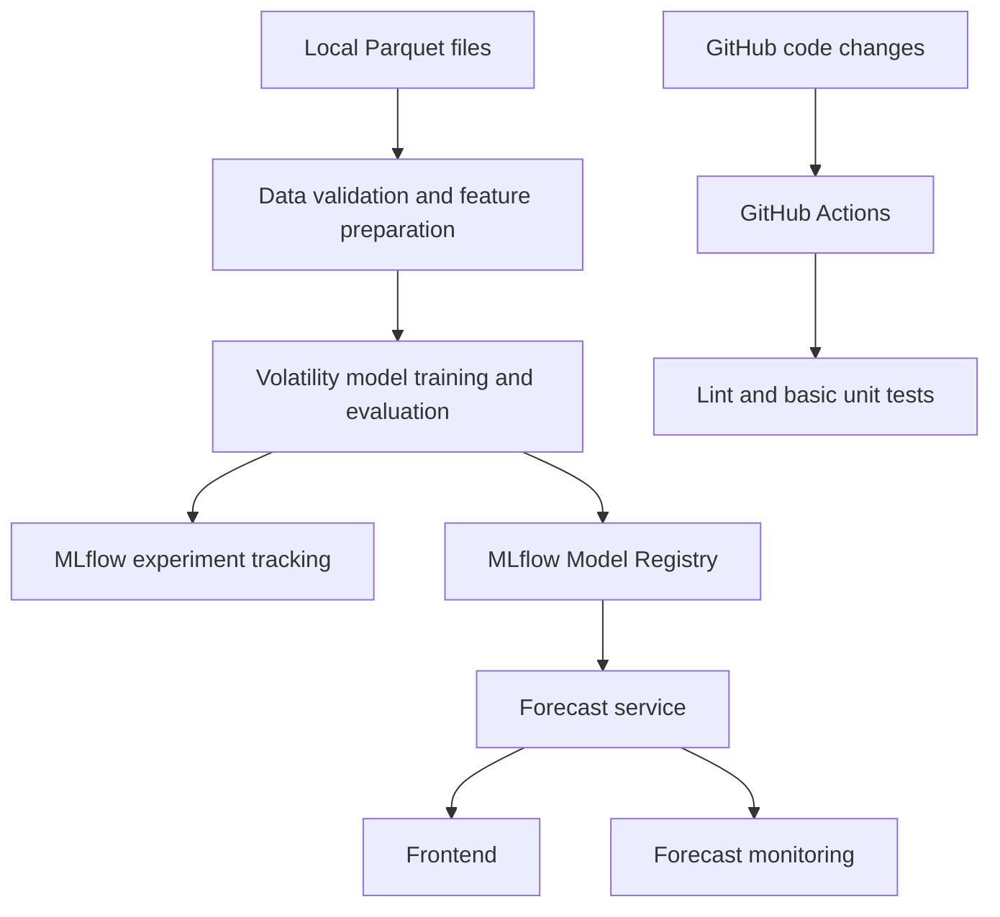

# Stock-Volatility-MLOps
INSY 684 — End-to-End MLOps for Stock Volatility Forecasting

# Temp
- data/ = Our two Parquet files (local only)
- notebooks/ = Existing INSY 674 notebooks, after checking for credentials and licensed outputs
- tests/ = Automated tests
- .github/workflows/ = GitHub Actions configuration

# Recommended Team Responsabilities:
- Francois = Responsibility: Model tracking and orchestration | branch: feature/model-tracking | MLflow experiments and registered model
- Team 2 = Responsibility: CI/CD and testing | branch: feature/ci-cd | Branch protection and basic unit tests
- Team 3 = Responsibility: Model serving and frontend | branch: feature/model-serving | Open branch and define implementation plan
- Pengxin = Responsibility: Monitoring and documentation | branch: feature/monitoring | Architecture diagram in README

## Planned Software Architecture

